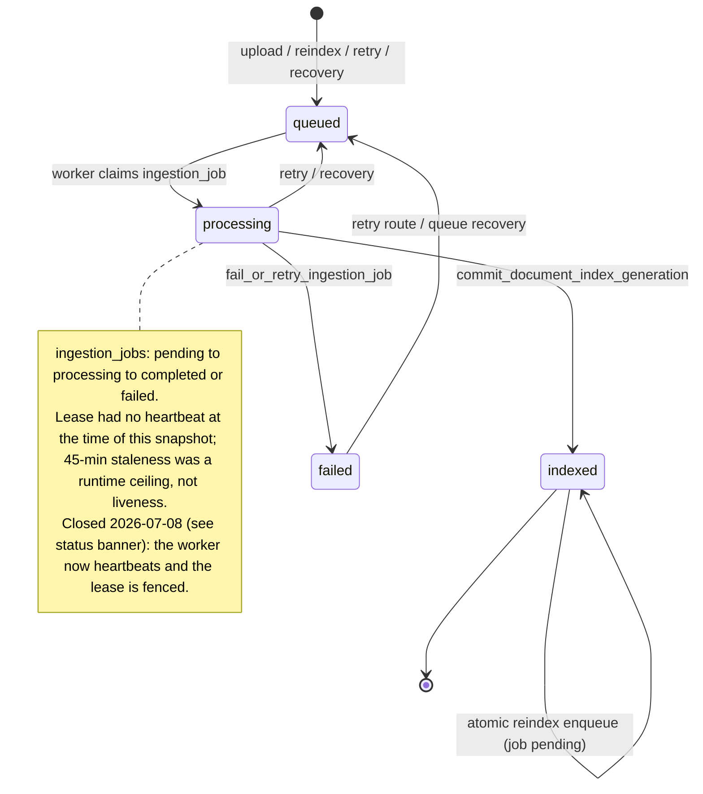

# Ingestion state machine — documents × ingestion_jobs × index generations

> **Status (2026-09-02): dated snapshot as of 2026-07-07.** The lease model described below
> (R1 "no heartbeat", R2 unfenced completion) was closed the day after this analysis: commit
> 79501bf75 (2026-07-08) added a guarded lease heartbeat in `worker/main.ts`
> (`updateJobProgress` refreshes `locked_at` only while `locked_by = workerId` and
> `status = 'processing'`, and throws "Ingestion lease lost" when zero rows match; the
> extraction phase runs it on a timer of at most 60 s, the general cadence is one third of
> `WORKER_STALE_AFTER_MINUTES`), and migration `20260708130000_ingestion_concurrency_rpc_hardening.sql`
> lease-fenced `complete_ingestion_job` / `fail_or_retry_ingestion_job` with `p_worker_id`
> (`ok:false` when the caller no longer holds the lease; the worker then stands down). The
> 45-minute stale window is therefore a **liveness** signal today: a live worker keeps its
> lease, and only a worker that has stopped heartbeating (crashed, OOM-killed, network-lost)
> is reclaimed. Statements below that say "no heartbeat" are kept as the historical record and
> are marked where they occur; read the runbooks for current operating guidance.

Phase-1 deliverable of the ingestion-concurrency/scale review (2026-07-07, branch
`claude/ingestion-concurrency-scale`). Documents every legal state of the ingestion
pipeline, which writer may perform each transition, what happens on a crash
between any two steps, and the verified concurrency violations. Fixes are
deliberately held until the db-reliability branch merges (phase 3).

**Method.** Seven scoped race-hunter agents (one per writer × transition group)
plus direct analysis produced a registry of claimed races; every claim was then
re-derived from the code by an independent adversarial verifier agent, which
had to state the exact reaching schedule (or the killing guard) for each. Two
facts were additionally checked against the live database catalog:
`ingestion_job_stages` has no `job_id → ingestion_jobs` FK on live (schema.sql
declares one), and the live `claim_indexing_v3_agent_jobs` has the seed-insert
and documents-join (schema.sql's copy has neither). Verdicts: 24/24 claims
confirmed (5 narrowed, 0 refuted). Seven violations are **deterministic** — no
concurrency required at all.

Companion docs: `docs/audit/repo-audit-2026-07-01.md` (M9/M11/M13 proved this
bug class live), `docs/audit/scale-readiness-review.md` (phase 2),
`docs/reindex-runbook.md`.

## Lifecycle at a glance

The `documents.status` lifecycle, with the writer/RPC for each transition (see §1 for the
column-level detail and the concurrency violations):

## 1. Entities and state columns

### documents (one row per document)

| Column                                     | Values / meaning                                                                                                                                                                                                                                                                                                 |
| ------------------------------------------ | ---------------------------------------------------------------------------------------------------------------------------------------------------------------------------------------------------------------------------------------------------------------------------------------------------------------- |
| `status`                                   | `queued` → `processing` → `indexed` \| `failed`. `queued` set by upload/reindex/retry routes and recovery; `processing` only by the local worker on the non-atomic path; `indexed` by `commit_document_index_generation`; `failed` by `fail_or_retry_ingestion_job`.                                             |
| `page_count`, `chunk_count`, `image_count` | Denormalized counts, written at commit **from client-side values**; zeroed by the non-atomic reindex enqueue and by recovery resets.                                                                                                                                                                             |
| `error_message`                            | Cleared at claim/enqueue, set by fail path.                                                                                                                                                                                                                                                                      |
| `metadata.index_generation_id`             | **The committed-generation pointer.** Artifact rows whose generation differs are invisible to readers (`is_committed_artifact_generation`) and are deleted by the commit RPC / abandoned-generation cleanup.                                                                                                     |
| `metadata.enrichment_status`               | `pending` \| `processing` \| `completed` \| `failed` \| `needs_enrichment_artifacts` (dual-written with `indexing_v3_agent_jobs.enrichment_status`).                                                                                                                                                             |
| `metadata.indexing_v3_agent_*`             | Legacy JSONB mirror of the agent job row: `status`, `locked_by`, `locked_at`, `next_run_at`, `attempt_count`, `deferral_count`, `last_error`. Dual-written by `claim_indexing_v3_agent_jobs`, the edge agent, and `complete_strict_enrichment_job`. The live claim RPC also **seeds** job rows from this mirror. |
| `updated_at`                               | Doubles as the **rollback fence** for queue-state writes (`ingestionRollbackFenceStamp`, microsecond-salted). No generic BEFORE UPDATE trigger on this table.                                                                                                                                                    |

### ingestion_jobs (many rows per document; core pipeline queue)

| Column                           | Values / meaning                                                                                                                                                                                                                                                                                                              |
| -------------------------------- | ----------------------------------------------------------------------------------------------------------------------------------------------------------------------------------------------------------------------------------------------------------------------------------------------------------------------------- |
| `status`                         | `pending` → `processing` → `completed` \| `failed`. `failed`+retry goes back to `pending`. No unique constraint prevents multiple open jobs per document.                                                                                                                                                                     |
| `stage`, `progress`              | Human-readable progress; drives UI.                                                                                                                                                                                                                                                                                           |
| `attempt_count` / `max_attempts` | Incremented **at claim** by `claim_ingestion_jobs`; reset to 0 by the retry route and queue recovery.                                                                                                                                                                                                                         |
| `locked_at`, `locked_by`         | Lease. Set at claim. **As of 2026-07-07 there was no heartbeat** — a running worker never refreshed `locked_at`; the lease only aged, so staleness (45 min default) was a _runtime ceiling_, not liveness. Closed 2026-07-08 (status banner): `updateJobProgress` now refreshes `locked_at` while the worker holds the lease. |
| `next_run_at`                    | Retry backoff (`nextRetryAt`, exp backoff capped 30 min). Also used as a per-request fence stamp by the retry route.                                                                                                                                                                                                          |
| `completed_at`                   | Terminal timestamp.                                                                                                                                                                                                                                                                                                           |

### indexing_v3_agent_jobs (exactly one row per document; enrichment queue)

| Column                           | Values / meaning                                                                                                                                             |
| -------------------------------- | ------------------------------------------------------------------------------------------------------------------------------------------------------------ |
| `status`                         | `pending` \| `processing` \| `completed` \| `failed` \| `needs_enrichment_artifacts`. `completed` and `needs_enrichment_artifacts` are **never re-claimed**. |
| `enrichment_status`              | Same domain; claim filter accepts (`pending`,`failed`,`processing`).                                                                                         |
| `attempt_count` / `max_attempts` | Incremented at claim (including claims that return nothing).                                                                                                 |
| `locked_by`, `locked_at`         | Lease, 45-min staleness, no heartbeat. Edge-function wall-clock is far below 45 min, so agent-vs-agent same-job overlap requires a crashed prior invocation. |
| `next_run_at`                    | Deferral / retry schedule (deferral ladder capped by `INDEXING_V3_MAX_DEFERRALS`).                                                                           |

Rows are seeded lazily _inside_ the live `claim_indexing_v3_agent_jobs` from
`documents.metadata.indexing_v3_agent_status` (`status='indexed'` docs only),
`on conflict (document_id) do nothing`.

### Index artifact tables

| Table                                                                                                | Generation column                                   | Notes                                                                                                                                                                                                             |
| ---------------------------------------------------------------------------------------------------- | --------------------------------------------------- | ----------------------------------------------------------------------------------------------------------------------------------------------------------------------------------------------------------------- |
| `document_pages`                                                                                     | none                                                | Replaced wholesale inside the commit RPC; `unique (document_id, page_number)`.                                                                                                                                    |
| `document_chunks`                                                                                    | typed `index_generation_id`                         | Uniqueness key includes the generation (`document_id, index_generation_id, chunk_index`) — so two concurrent builds **never collide** on chunks; there is no unique-constraint safety net against a double-build. |
| `document_images`                                                                                    | typed + `metadata->>'index_generation_id'` fallback | Storage path embeds the generation: `{owner}/images/{doc}/{generation}/image-N.ext`.                                                                                                                              |
| `document_sections`                                                                                  | typed + metadata fallback                           | `unique (document_id, section_index)` — the collision surface between concurrent enrichment writers.                                                                                                              |
| `document_table_facts`, `document_embedding_fields`, `document_index_units`, `document_memory_cards` | typed + metadata fallback                           | Edge-agent rows carry `metadata.generated_by='indexing-v3-agent'` and **no generation id** (NULL generation = always visible). No unique constraint on `document_index_units`.                                    |
| `document_index_quality`                                                                             | none (1 row/doc)                                    | Upserted by worker commit, edge agent, and strict-completion RPC (monotonic `greatest()` merges).                                                                                                                 |
| `document_summaries`, `document_labels`                                                              | none                                                | Shared between edge agent, worker inline enrichment, and route enrichment.                                                                                                                                        |

### Storage + ledgers

- Document bucket: source file at `documents.storage_path` (uploaded before the
  document row exists).
- Image bucket: per-generation prefixes. **The only ledger writer is the DELETE
  route** (`storage_cleanup_jobs`); `scripts/cleanup-storage.ts` drains the
  ledger (`status in ('pending','failed')`); nothing lists bucket prefixes.
- `ingestion_job_stages`: append-only stage log written by the edge agent.
  Live has only the `document_id → documents` FK; schema.sql additionally
  declares `job_id → ingestion_jobs(id)` (drift — see R24e).

## 2. Writers

| Writer                                                                | Identity                                  | Touches                                                                                                                                                                                                                                                                                                                                                                                                                                                                                                                                                                                  |
| --------------------------------------------------------------------- | ----------------------------------------- | ---------------------------------------------------------------------------------------------------------------------------------------------------------------------------------------------------------------------------------------------------------------------------------------------------------------------------------------------------------------------------------------------------------------------------------------------------------------------------------------------------------------------------------------------------------------------------------------- |
| **W1 — local worker** (`worker/main.ts`)                              | service-role PostgREST                    | `claim_ingestion_jobs`, `reset_document_index`, all artifact inserts, image-bucket uploads, `commit_document_index_generation`, `complete_ingestion_job` / `fail_or_retry_ingestion_job`, `complete_strict_enrichment_job`, unconditional `documents` updates, inline enrichment (deep-memory) when `WORKER_INLINE_ENRICHMENT`. Packet B4 (`WORKER_DOCUMENT_EXTRACTOR_MODE=shadow`, default `legacy`) adds **no writer and no transition**: docling runs after T5 commit and its aggregate `shadow_extraction` key rides the existing T6 metadata merge (`worker/shadow-extraction.ts`). |
| **W2 — edge agent** (`supabase/functions/indexing-v3-agent/index.ts`) | direct Postgres (postgres.js, pool max 4) | `claim_indexing_v3_agent_jobs`, delete+insert cycles on embedding fields / index units / memory cards / sections / labels / summaries, `document_images.metadata` patches, `update_indexing_v3_agent_job_status` (keyed by document_id, no lock-holder check), `complete_strict_enrichment_job`, jsonb-merge patches of `documents.metadata`.                                                                                                                                                                                                                                            |
| **W3 — API routes** (`src/app/api/...`)                               | service-role PostgREST                    | upload; reindex single/bulk (fence-stamped queue-state write + job insert); **reindex `mode:'enrichment'`** (runs deep-memory/enrichment in-route with **no job row and no fence**); retry (guarded job reset + **unguarded document status write**); delete single (guard → enumerate → ledger → cascade → storage remove); rename / bulk metadata edit (read-modify-write of `documents.metadata`).                                                                                                                                                                                    |
| **W4 — ops** (scripts + SQL)                                          | service-role                              | `scripts/recover-ingestion-queue.ts` + `scripts/reindex.ts` (supersede/retry plans, `reset_document_index`, attempt_count=0 re-pends), `cleanup_abandoned_document_index_generations`, `scripts/cleanup-storage.ts` (ledger janitor), cron `invoke_indexing_v3_agent`.                                                                                                                                                                                                                                                                                                                   |

## 3. Legal composite states

`D:` = `documents.status`, `J:` = newest `ingestion_jobs` row, `A:` = the
`indexing_v3_agent_jobs` row, `G:` = `metadata.index_generation_id`.

| #   | State                                                                     | Legal because                                                                                                                                                    |
| --- | ------------------------------------------------------------------------- | ---------------------------------------------------------------------------------------------------------------------------------------------------------------- |
| S0  | no rows                                                                   | pre-upload.                                                                                                                                                      |
| S1  | storage object only                                                       | upload crash window U1; invisible; leaks.                                                                                                                        |
| S2  | `D:queued`, `J:pending`, `G:∅`                                            | fresh upload awaiting first claim.                                                                                                                               |
| S3  | `D:processing`, `J:processing(locked)`, `G:∅`                             | first index build; index tables empty (reset ran).                                                                                                               |
| S4  | `D:queued`/`processing`, `J:processing`, staged rows `G'≠G`               | mid-build; staged generation invisible to readers.                                                                                                               |
| S5  | `D:indexed`, `G:G'`, `J:processing`                                       | commit done, completion RPC not yet run.                                                                                                                         |
| S6  | `D:indexed`, `G:G'`, `J:completed`, `A:pending`                           | steady state awaiting enrichment.                                                                                                                                |
| S7  | `D:indexed`, `A:processing(locked)`                                       | agent enriching; generation-less agent artifacts appear incrementally (each row is visible the moment it is inserted — enrichment is **not** generation-fenced). |
| S8  | `D:indexed`, `A:completed`, `enrichment_status:completed`                 | fully enriched (strict gate passed).                                                                                                                             |
| S9  | `D:indexed`, `A:needs_enrichment_artifacts`                               | deferral ladder exhausted; terminal — never re-claimed.                                                                                                          |
| S10 | `D:failed`, `J:failed`                                                    | terminal failure.                                                                                                                                                |
| S11 | `D:indexed`, `J:pending` (reindex)                                        | atomic reindex queued; old generation stays live until the new commit swaps `G`.                                                                                 |
| S12 | `D:queued`, `J:pending`, `G:G₀`, counts zeroed                            | non-atomic reindex of a failed/queued doc; old artifacts (if any) present until the worker's reset.                                                              |
| S13 | `D:indexed`, `J:failed(stage='needs recovery after partial index write')` | duplicate-key partial write routed to manual recovery.                                                                                                           |

Everything else observed is a violation (§6).

## 4. Transition table (writer × transition)

| Transition                                                                                                                                                                          | Guard / mechanism                                                                                                                                                                                       | Allowed writer(s)                         |
| ----------------------------------------------------------------------------------------------------------------------------------------------------------------------------------- | ------------------------------------------------------------------------------------------------------------------------------------------------------------------------------------------------------- | ----------------------------------------- |
| T1 upload: storage put → `documents` insert (`queued`) → `ingestion_jobs` insert (`pending`)                                                                                        | `upsert:false` storage put; compensating document delete on job-insert failure (error path only)                                                                                                        | W3                                        |
| T2 claim: `J:pending→processing`, `attempt_count++`, lease set                                                                                                                      | `claim_ingestion_jobs`: `FOR UPDATE … SKIP LOCKED` on job+document rows; excludes docs with a _fresh_ processing sibling; reclaims stale (>45 min) processing jobs — including live ones (no heartbeat) | W1                                        |
| T3 reset (non-atomic path): delete **all** index rows incl. pages, generation-blind                                                                                                 | `reset_document_index`; runs whenever claim-time `D≠indexed`                                                                                                                                            | W1, W4 (recovery/reindex scripts)         |
| T4 build: storage image uploads + staged artifact inserts under new `G'`                                                                                                            | none (rows invisible via generation predicate; storage uploads unledgered)                                                                                                                              | W1                                        |
| T5 commit: `D→indexed`, `G:=G'`, pages replaced, other-generation rows deleted (legacy NULL rows preserved unless replaced), **counts written from client-side values**             | `commit_document_index_generation` (single transaction, 180 s timeout)                                                                                                                                  | W1                                        |
| T6 final metadata write: full `documents.metadata` **replace** built from claim-time snapshot                                                                                       | unconditional (`worker/main.ts:1783`, also the commit RPC's `p_metadata` replace and the strict-blocked variant at 1796)                                                                                | W1 (violation source: R3/R5)              |
| T7 complete: `J→completed`, all pending/processing/failed siblings force-completed, batch refresh                                                                                   | `complete_ingestion_job` (no `locked_by` fence)                                                                                                                                                         | W1                                        |
| T8 fail/retry: `J→failed` or `→pending`+`next_run_at`, locks nulled; `D→failed`/`queued`/`indexed` per claim-time flag                                                              | `fail_or_retry_ingestion_job` (unconditional, no fence)                                                                                                                                                 | W1                                        |
| T9 agent claim: seed job rows from metadata mirror, `A:→processing`, `attempt_count++`, jsonb metadata patch                                                                        | `claim_indexing_v3_agent_jobs` (SKIP LOCKED; live joins `d.status='indexed'`)                                                                                                                           | W2                                        |
| T10 enrichment writes: delete+insert cycles per artifact family (agent scopes deletes to its own `generated_by`; worker/route deep-memory deletes are **unscoped**)                 | per-family; only the agent's visual deletes are transactional                                                                                                                                           | W2, W1 (inline), W3 (`mode:'enrichment'`) |
| T11 agent complete: strict gate → metadata merge + `A→completed`                                                                                                                    | `complete_strict_enrichment_job` (`FOR UPDATE` on the document row — the only lock any enrichment writer takes)                                                                                         | W2, W1                                    |
| T12 agent defer/fail: metadata merge + `update_indexing_v3_agent_job_status`                                                                                                        | keyed by `document_id`, no lock-holder check                                                                                                                                                            | W2                                        |
| T13 reindex enqueue: fence-stamped queue-state write + `J:pending` insert; compensating fence rollback (error path only)                                                            | `checkIngestionMutationSafety` (advisory 409; reads `ingestion_jobs` only)                                                                                                                              | W3                                        |
| T14 retry: conditional job reset (refuses fresh `processing` locks; accepts failed **and completed** jobs) + unconditional `D→queued`                                               | single conditional UPDATE + fence for the job row; **no guard on the document write**                                                                                                                   | W3                                        |
| T15 delete: active-jobs guard → enumerate paths → ledger insert → late re-guard → trace cleanup → cascade delete → storage remove                                                   | M9 fix in place; both checks advisory; abort paths leave the ledger row `failed` **with paths populated**                                                                                               | W3                                        |
| T16 queue recovery: supersede (indexed + chunk_count>0 + J≠completed — includes `pending`) or retry-with-reset (everything else incl. plain `pending` and stale-alive `processing`) | `buildIngestionRecoveryPlan`; plan applied after an unbounded interactive confirm with no re-check; writes have no status guards; `attempt_count=0`                                                     | W4                                        |
| T17 abandoned-generation cleanup: delete artifact rows with `G≠committed`                                                                                                           | job-existence guard **only in the candidate CTE**; counts/deletes re-check generation only, each on a fresh snapshot                                                                                    | W4                                        |
| T18 ledger janitor: remove storage objects listed in `storage_cleanup_jobs` rows with `status in ('pending','failed')`                                                              | no check that the document still exists                                                                                                                                                                 | W4                                        |

## 5. Crash-window analysis

Crash = process death / network loss between two adjacent steps. Because there
was no lease heartbeat at the time of this snapshot, every worker window below also has a
"slow, not crashed" variant after 45 minutes (closed 2026-07-08 — see the status banner).

**Upload (W3)** — R14

- U1: after storage put, before `documents` insert → orphaned storage object;
  no ledger, no sweeper. A failed compensating remove is likewise only logged.
- U2: after `documents` insert, before job insert (crash, or rollback-delete
  failure) → `D:queued` with no job — invisible to the claim RPC _and_ to
  queue recovery (both scan `ingestion_jobs`). Only `reindex.ts`'s
  incomplete-documents counter hints at it.

**Worker (W1)**

- C1: crash after claim → job `processing` until stale reclaim; attempt burned.
- C1a (2026-10-16): on a job's final attempt, an uncertain outcome (a crash, a lost
  connection, or SQLSTATE 40003) leaves the job `processing` with no stale reclaim, because
  `claim_ingestion_jobs` skips jobs at `max_attempts`. The owner decided on 2026-10-16 not to add
  an automatic database recovery for this. The 6-hourly ingestion autopilot reads only the 25
  oldest open jobs (`scripts/reindex-health.ts`) and flags a `processing` job among them locked for
  more than 30 minutes. A stuck job behind a larger backlog is therefore flagged only once the
  older jobs ahead of it clear. Queue recovery (T16) scans every open job, so running it directly
  resets the job whether or not the autopilot has flagged it.
- C2 (non-atomic only): crash after reset → document has zero index rows and
  `D:processing` until reclaim. Steady-state docs are safe (atomic path skips
  T3) — but see R15 for how the retry route re-opens this for indexed docs.
- C3: crash mid-T4 → staged rows (cleaned by T17) + storage objects under the
  never-committed generation prefix, permanently stranded (R12 family).
- C4: crash between T5 and T7 → S5; stale reclaim re-runs as atomic reindex;
  converges at the cost of a full rebuild + another stranded storage generation.
- C5: crash between T5 and T6 → commit metadata already carries
  `indexing_v3_agent_status='pending'`; agent path still triggers. Converges.
- C6: crash inside T8's PostgREST fallback between document and job updates →
  `D:failed` with `J:processing(stale)`; reclaim/recovery converge it.

**Edge agent (W2)**

- E1: crash after T9 → `A:processing`; stale reclaim after 45 min; benign.
- E2: crash (or OpenAI failure) mid-T10 → the family being rebuilt was already
  deleted; family stays empty until a later pass — and if attempts exhaust or
  the deferral ladder terminates, **permanently** (R24a).
- E3: crash between T11's document update and the job-status RPC → metadata
  says completed, job row processing; next pass hits the gate-complete fast
  path and re-completes. Converges.

**API routes (W3)**

- R1w: reindex enqueue crash between queue-state write and job insert →
  `D:queued`, counts zeroed, no job (non-indexed docs only; atomic variant
  touches only `error_message`). Narrowed: usually an old failed job still
  exists for recovery to find; truly stuck only when no job rows remain (R18).
- R2w: retry crash between job reset and document update → `J:pending` with
  `D:failed`; worker fixes status at claim. Converges.
- R3w: delete crash after cascade, before storage removal → ledger row records
  what to remove; recoverable **but see R11** — the same ledger row becomes a
  loaded gun if the delete aborted instead of crashing.

## 6. Verified violations (adversarial verifier verdicts; 0 refuted)

Classes: [DATA-LOSS] destroys committed clinical data or storage;
[SILENT-CORRUPTION] wrong/partial data served with no error; [AVAILABILITY]
stuck pipeline states; [STORAGE-LEAK]; [OPS-CHURN]; [FRESH-ENV-ONLY].
**DET** = deterministic, no concurrency required.

### Tier 1 — destroys good data

**R11 [DATA-LOSS, DET] — Aborted DELETE poisons the cleanup ledger; the janitor destroys a LIVE document's storage.**
The DELETE route creates the `storage_cleanup_jobs` row (with the live doc's
source-PDF + image paths) _before_ the late re-check; every abort path (late
re-check 409, trace-cleanup failure, DB-delete failure) marks it `failed`
without clearing the paths (`route.ts:545-593`; `updateStorageCleanupJob` never
touches paths). `scripts/cleanup-storage.ts:69` selects `status in
('pending','failed')` and never checks the document still exists — although the
FK is `on delete set null`, so a non-null `document_id` _proves_ the doc is
alive. One transient error + one routine janitor run permanently deletes a live
document's PDF and images. A janitor run can also consume the `pending` row
concurrently with an in-flight DELETE that later aborts.

**R15 [DATA-LOSS, DET] — Retrying a failed (or completed) job of an indexed document destroys its live committed index.**
The retry route's guard only rejects fresh-processing jobs, then unconditionally
sets `documents.status='queued'` (`retry/route.ts:69, 91-95`). The next claim
sees `queued` → non-atomic → `reset_document_index` deletes the entire live
index at job start, hours before any replacement commit; a second failure
leaves `failed` with zero index. The IDX-H1 comment's promise ("the prior index
stays live until the worker commits") is defeated by this route's own status
write. Defeats the atomic-reindex design for exactly the docs it protects.

**R3 [DATA-LOSS] — Double-build metadata repoint, then cleanup deletes the survivors.**
Under R1 (stale reclaim of a live >45-min job), the loser's post-commit
full-replace metadata write (`worker/main.ts:1783`, containing its own
generation id) can land after the winner's commit → the pointer names a
deleted generation → every row fails the committed-generation predicate →
document "indexed" but retrieval-empty; `cleanup_abandoned_document_index_generations`
then deletes the surviving winner rows permanently.

**R24d [DATA-LOSS/SILENT-CORRUPTION] — Route-enrichment vs agent: "completed/good" documents with zero artifacts; no repair path exists.**
Reindex `mode:'enrichment'` creates no job row and its safety check reads only
`ingestion_jobs`, so it runs freely against a live agent pass. Deep-memory
deletes ALL index units/cards/sections unscoped (`deep-memory.ts:700-706`);
document-enrichment deletes all generated labels; the agent's own-scoped
deletes can't see the route's rows. Confirmed end states: duplicate
`section_summary` index units (no unique constraint), memory cards detached by
`section_id ON DELETE SET NULL`, dangling jsonb section references — and the
strict gate can complete (quality force-promoted to `good`) immediately before
a late delete-all lands whose re-insert then fails → completed/good document
with **zero** enrichment artifacts. `repair_strict_enrichment_gate_batch`
exists in schema but is invoked by nothing.

### Tier 2 — silently corrupts committed indexes

**R4 / R19 / R23 [SILENT-CORRUPTION] — Generation-blind resets amputate a live build; commit stamps full client-side counts over the partial row set.**
Three writers run `reset_document_index` (or generation-mismatch deletes)
against a document another worker is actively building: a reclaiming worker
(R4, needs R1), queue recovery retrying a stale-but-alive or merely-`pending`
job (R19 — `buildIngestionRecoveryPlan` treats plain `pending` as
retry-with-reset, and **runbook line 48 directs operators to run recovery in
exactly this state**; `reindex.ts` then spawns `worker:once` itself), and
`cleanup_abandoned_document_index_generations` (R23 — the job-existence guard
lives only in the candidate CTE; the 7 counts + 7 deletes re-check generation
only, each on a fresh READ COMMITTED snapshot, so a reindex claimed after
selection has its staged rows deleted table-by-table, leaving internally
inconsistent survivors). In all three the original worker's commit succeeds
with `p_chunk_count = chunks.length` computed client-side
(`worker/main.ts:1665-1674`) — indexed document, inflated counts, an arbitrary
prefix of rows missing, no error, no flag; `reindex-health` counts documents
and jobs, never chunks.

**R2 / R5 / R6 / R8 [SILENT-CORRUPTION/OPS-CHURN] — No write is fenced by `locked_by`; the writer set is multi-master after any 45-min job.**
`complete_ingestion_job`, `fail_or_retry_ingestion_job`, `updateJob`,
`updateDocument`, and the commit RPC all write by id with no lease check.
Confirmed consequences under R1/R8: a zombie's failure flips a freshly-indexed
document to `failed` (with a message directing the operator to run the recovery
script — see R19) and a completed job to failed/pending (R2); the worker's
full-replace metadata writes erase concurrent bulk metadata edits, renames, and
agent state patches (R5 — three replace sites: commit `p_metadata`, line 1783,
line 1796); a loser's retryable failure re-pends the job and NULLs the
winner's live lock, inviting a third concurrent worker, or resurrects a
completed job into a zombie re-ingest (R6); an attempt-exhausted stale sibling
neither blocks nor ranks, so a pending sibling is claimed alongside the old
holder, whose row the first finisher force-completes and the loser then
resurrects (R8).

**R24a [SILENT-CORRUPTION] — Agent artifact rebuilds delete before the OpenAI call; terminal jobs are never re-claimed.**
All four families (core embedding fields, memory cards, section index units,
visual) delete agent-generated rows, then call OpenAI, then insert row-by-row
(only the visual _deletes_ are transactional). A persistent OpenAI outage
across the retry budget, or a deferral-ladder exhaustion, leaves families
empty **permanently**: `failed` (attempts) and `needs_enrichment_artifacts`
are both excluded from claim eligibility forever. Narrowed: deletes are scoped
to `generated_by='indexing-v3-agent'`, which for agent-enriched documents is
the entire family.

**R24c [SILENT-CORRUPTION] — Live seed-insert makes worker-inline-enrichment vs agent overlap deterministic.**
The worker's core commit writes `indexing_v3_agent_status='pending'` _before_
its multi-minute inline enrichment; any cron tick in that window seeds+claims
the job and runs concurrently: unique `(document_id, section_index)` collisions
fail the worker's enrichment, section deletes FK-break the agent's card
inserts, and the worker's metadata replace overwrites the agent's completion →
`completed` job row with a `pending` metadata mirror that nothing reconciles;
heuristic agent artifacts (first-1800-char summary, chunk-per-section) can
permanently displace LLM enrichment.

**R10 [SILENT-CORRUPTION, narrowed] — Claim-time `atomicReindex` stamps `indexed` onto an emptied document.**
An atomic-claim worker failing after a composed reset (R15 → sibling
non-atomic claim → reset) writes `status='indexed'` unconditionally → ghost
document: `indexed`, zero chunks. Recovery's supersede branch misses it
(`chunk_count>0` gate); its retry branch eventually catches the leftover job.

### Tier 3 — operator tooling (all confirmed against the runbook's actual guidance: it never says to quiesce workers)

**R20 [DATA-LOSS window] — Recovery's interactive confirm is an unbounded plan→apply TOCTOU.**
The plan is computed, the script blocks on `confirm(...)`, then applies the
stale plan verbatim with no status re-checks: a document whose job completed
during the wait gets its **freshly committed healthy index reset** (doc →
queued, counts zeroed) and its completed job flipped to pending,
`attempt_count=0`.

**R22 [OPS-CHURN, DET] — Recovery supersede silently cancels every queued reindex of an indexed document.**
Plan rule `indexed && chunk_count>0 && status!='completed'` → supersede
includes plain `pending` jobs, so a routine `recover:ingestion --apply` marks
legitimately queued reindex jobs "completed / superseded by successful index".
The reindex never happens; nothing reports it.

**R21 [SILENT-CORRUPTION] — Recovery's `attempt_count=0` re-pend on the same row a live worker holds → instant double-build.**
The anti-double-claim guard checks only _sibling_ rows, so the reset row is
immediately claimable — no further 45-minute wait; `reindex.ts` runs
`worker:once` right afterwards, orchestrating the race single-handedly. The
`attempt_count=0` overwrite also defeats `max_attempts` indefinitely for
poison documents.

**R9 / R7 [AVAILABILITY] — Batches that never complete.**
R9: the batch's last two jobs completing in overlapping transactions both
compute `processing` from pre-commit snapshots; the second write is a classic
lost update → all jobs terminal, batch `processing` forever (reachable from a
single worker's `Promise.all`). R7: a zombie's stale-snapshot retry re-pends a
job whose DB `attempt_count` already equals `max_attempts` → permanently
unclaimable pending job pinning its batch. Both ops-recoverable.

### Tier 4 — leaks, strandings, drift

**R12 [STORAGE-LEAK, DET] — Every successful reindex permanently strands the previous generation's image objects.**
Commit deletes old `document_images` rows only; the delete route enumerates
current rows; no ledger entry, sweeper, or prefix listing ever sees the old
`{owner}/images/{doc}/{oldGen}/` objects again. Crash/double-build variants
(C3, R3) strand additional generations. Unbounded bucket growth.

**R13 [STORAGE-LEAK, narrowed] — Delete TOCTOU beyond M9.**
A reindex enqueued+claimed between the late re-check and the cascade delete
puts a worker mid-build on a deleted document: silent 0-row updates, new-
generation storage uploads no ledger references, FK failure ends the run, and
the reindex caller holds a 201 for a ghost job. Narrow window (worker poll must
land inside the trace-cleanup seconds).

**R14 [STORAGE-LEAK/AVAILABILITY, DET on crash] — Upload durability gaps.**
Storage-put orphans (no ledger), unledgered compensating-remove failures, and
the `queued`-doc-with-no-job zombie invisible to claim and recovery.

**R16 [AVAILABILITY, narrowed] — Retry's late document write → sticky `queued` indexed doc.**
Requires the route to stall between its two writes for a full claim+build;
when it lands, all future reindexes of that doc take the destructive
non-atomic path (feeds R15's damage without another retry).

**R17 [OPS-CHURN] — Concurrent reindex POSTs.** Duplicate open jobs (no unique
constraint); benign via completion-time supersede except when the first job
exceeds 45 min (dual ingest via R8) or exhausts attempts (redundant rebuild).

**R18 [AVAILABILITY, narrowed, DET on crash] — Reindex enqueue crash strands `queued`+zeroed-counts docs** — truly stuck only when no other job rows remain for recovery to find.

**R24b [AVAILABILITY] — Agent mid-batch failure strands the rest of the batch.**
`markJobFailure` on a cascade-deleted document throws inside the loop's catch
(job-status RPC returns `ok:false` → throw), abandoning the remaining claimed
jobs locked for 45 min with attempts burned; three such events make innocent
jobs permanently unclaimable. `update_indexing_v3_agent_job_status` is keyed by
`document_id` with no lock-holder check.

**R24e / R1 drift [FRESH-ENV-ONLY] — schema.sql diverges from live in two load-bearing places.**
(a) schema.sql declares `ingestion_job_stages.job_id → ingestion_jobs(id)`;
the agent inserts `indexing_v3_agent_jobs.id` → on any schema.sql-provisioned
environment every needs-work agent run dies at its first `stageStart` (FK 23503) and burns attempts to terminal `failed`. Live has no such FK (verified
against the live catalog). (b) schema.sql's `claim_indexing_v3_agent_jobs`
lacks the seed-insert and the `d.status='indexed'` join that live has
(migration 20260705230000): fresh environments never seed agent jobs
(enrichment silently inert) and claim rows for mid-reindex docs that are then
never returned, burning attempts invisibly. Tests and scratch environments are
validating a different state machine than production runs.

**R1 [enabler] — No lease heartbeat (closed 2026-07-08; see the status banner).** Confirmed root enabler for R2-R8: any
job >45 min is reclaimed while its worker is alive, with `WORKER_STALE_AFTER_MINUTES`
acting as a hard runtime ceiling rather than a liveness signal. On its own it
costs double compute; composed, it produces everything in Tier 2.

## 7. Non-violations checked and cleared

- Retry-vs-claim job-row clobber (IDX-C3/B6): the conditional-UPDATE guard is
  sound _for the job row_ — a fresh `processing` lock refuses the reset. (The
  route's **document** write is R15/R16 — the guard never covered it.)
- Reindex rollback fence (`ingestionRollbackFenceStamp`): microsecond-salted
  `updated_at` match makes stale rollbacks no-ops on the error path. Cleared
  (crash path is R18, a durability gap, not a race).
- Commit RPC legacy-artifact preservation (M13 fix): replacement-exists
  predicates verified in both the RPC and the client fallback. Cleared.
- `complete_strict_enrichment_job` takes `FOR UPDATE` on the document row —
  serializes W1-inline vs W2 _completion_ (not artifact writes). Cleared.
- Same-instant double _claim_ of one job: `FOR UPDATE SKIP LOCKED` is correct.
  Cleared (the reclaim-while-alive case is R1, a lease-liveness problem).
- Upload duplicate-content race: closed by the partial unique index +
  `duplicateUploadResponse`. Cleared.
- M9's original window (path enumeration vs pending job): the added `pending`
  guard + late re-check work as designed; what survives is R11/R13 around them.

## 8. Fix backlog (phase 3 — HELD until db-reliability merges)

Ranked by damage-per-effort; smallest safe change each; migrations as committed
files only (never raw SQL against live; pause and confirm before applying any
migration to the live project).

1. **R11**: janitor guard — skip `storage_cleanup_jobs` rows whose
   `document_id` still resolves (FK is `on delete set null`, so non-null id ⇒
   live doc); clear paths (or use a distinct `aborted` status) on the DELETE
   route's abort paths.
2. **R15/R16**: retry route — stop demoting indexed documents: only set
   `status='queued'` when the document is not `indexed` (single conditional
   UPDATE), and reject retries of `completed` jobs.
3. **R1/R2 root fix**: lease heartbeat — refresh `locked_at` (guarded by
   `locked_by = workerId`) inside `updateJobProgress`; add
   `and locked_by = p_worker_id` to `complete_ingestion_job` /
   `fail_or_retry_ingestion_job`; worker aborts the job when a lease write
   matches 0 rows. Kills R3-R8 as a class.
4. **R5**: replace the three full-metadata writes with server-side jsonb
   merges scoped to worker-owned keys (or fence on `updated_at`).
5. **R19/R20/R21/R22**: recovery hardening — re-select plan state after
   `confirm`; status-guarded conditional updates (`.eq('status', expected)`);
   don't reset `attempt_count` to 0 on rows with a live lock; exclude
   `pending` jobs younger than the plan snapshot from supersede.
6. **R24d/R24c**: give route-enrichment and worker-inline enrichment a gate on
   `indexing_v3_agent_jobs` (extend `checkIngestionMutationSafety`), or take
   the document `FOR UPDATE` around family rebuilds; scope deep-memory deletes
   to its own `generated_by`.
7. **R12 (+R13/R14/C3)**: storage reconciliation — write `storage_cleanup_jobs`
   rows for superseded generations at commit time (the RPC knows both
   generation ids), and a periodic prefix-vs-committed-generation sweep.
8. **R23**: repeat the job-existence guard inside cleanup's delete predicates.
9. **R9**: recompute batch counts after acquiring the `import_batches` row
   lock (`select … for update` then count, or make the UPDATE self-computing).
10. **R24a**: stage-then-swap for agent families (insert new tag, delete old
    tag after success); add a re-open path for `needs_enrichment_artifacts`.
11. **R24b**: wrap `markJobFailure` in its own try/catch inside the batch loop.
12. **R24e + claim-RPC drift**: re-sync schema.sql with live (drop the
    job_id FK or repoint it; adopt the migration's claim RPC body); add a
    `search_schema_health` check for both.
13. **R7**: clamp `attempt_count` writes (`least(attempt_count, max_attempts)`)
    or have the claim filter accept `attempt_count <= max_attempts` for
    `pending` rows re-pended by the fail path.
14. **R17**: partial unique index on `ingestion_jobs(document_id) where status
in ('pending','processing')` — also structurally closes R13's enqueue arm
    and simplifies M9's guards.

Verification gates for phase 3 (per instruction): `npm run verify:cheap`,
`npm run check:indexing`, `npm run reindex:health`.
