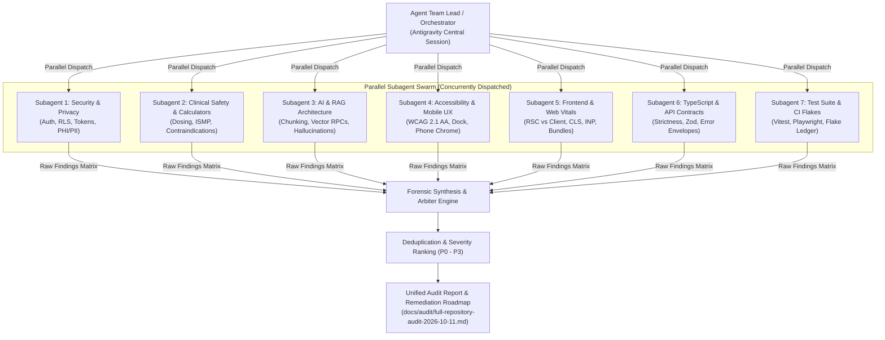

# Parallel Subagent Full Repository Audit Implementation Plan

> **For agentic workers:** REQUIRED SUB-SKILL: Use `superpowers:subagent-driven-development` (recommended) or `superpowers:executing-plans` to implement this plan task-by-task. Steps use checkbox (`- [ ]`) syntax for tracking.

**Goal:** Execute an exhaustive, evidence-backed, parallel multi-subagent audit across the entire PsychSift repository (`BigSimmo/PsychSift`) to identify all latent bugs, security vulnerabilities, clinical safety hazards, accessibility issues, performance bottlenecks, and architectural debt without mutating source code.

**Architecture:** Decompose repository auditing into seven orthogonal, non-overlapping investigation domains executed concurrently via specialized read-only subagents (`dispatching-parallel-agents`, `review-swarm`). A central orchestrator aggregates, forensically verifies, deduplicates, and ranks all findings into a unified, reproducible report (`docs/audit/full-repository-audit-2026-10-11.md`), using `docs/codex-review-protocol.md` as the review protocol.

**Tech Stack:** Next.js 16 (App Router, RSC/Client boundaries), React 19, TypeScript 5.8, Tailwind CSS, Supabase (PostgreSQL, pgvector, RLS), Vitest, Playwright, Python worker (`worker/python`), Docker, GitHub Actions CI.

**Spec / Baseline:** `docs/audit/full-repository-adversarial-audit-2026-10-09.md`, `docs/codex-review-protocol.md`, `AGENTS.md`.

---

## Global Constraints

- **Strictly Read-Only:** The audit does not modify, delete, format, or commit code unless explicitly authorized in a subsequent remediation phase.
- **Dev Drive Safeguards:** Under no circumstances delete, prune, or clean any directory under `D:\Worktrees` or `D:\Repos`.
- **Zero Live Provider Calls Without Explicit Approval:** Offline static analysis and local test verification only; no calls to live Supabase production, OpenAI, or external APIs without explicit confirmation.
- **Evidence-First Standard:** Every finding must provide an exact file path, line numbers, trigger scenario, clinical or technical impact, and a minimal reproducible test or query.
- **Clinical & Privacy First:** Adhere to Australian digital health standards, ISMP medication safety rules, and strict synthetic patient data compliance.

---

## Swarm Architecture Diagram

---

## Review Focus (Key Failure Modes to Investigate)

1. **Silent Production Migration Deployment:** Any Supabase migration merged to `main` deploys to live clinical production within 34 seconds. Any un-transacted migration or broken index guard could break the live database.
2. **Clinical Medication & Calculator Inaccuracies:** Unchecked edge cases in creatinine clearance, lithium/clozapine dosing, QT prolongation calculations, or unit mismatches that could present false guidance to a clinician.
3. **RAG Extractive Answer Hallucinations & Truncation:** Token limit overflows or improper chunk boundaries in `src/lib/rag/**` dropping critical contraindication sections or misattributing citations.
4. **Mobile Search Chrome & Virtual Keyboard Collisions:** Collisions between sticky bottom action bars, mobile docks, and native iOS/Android software keyboards violating the zero-reserve safe-area contract.
5. **State Leaks & Cross-Tenant Data Isolation:** In-memory `Map` or singleton stores in API routes (`/api/**`) that leak state across concurrent user sessions or serverless instance reboots.

---

## Detailed Audit Tasks

### Task 1: Environment Baseline & Read-Only Repository Mapping

**Files:**

- Read: `package.json`, `tsconfig.json`, `AGENTS.md`, `docs/outstanding-issues.md`
- Inspect: Active branch `feat/scoped-resilience-and-ui-hardening` vs `origin/main`

**Goal:** Establish clean, uncontaminated baseline facts on local HEAD divergence, branch history, and existing known ledger items before dispatching subagents.

- [ ] **Step 1: Check git status, current SHA, and diff relative to `origin/main`**
- [ ] **Step 2: Inventory current unclosed items in `docs/outstanding-issues.md` to avoid redundant reporting**
- [ ] **Step 3: Verify local test/typecheck baseline without mutating any files**

---

### Task 2: Subagent 1 — Security, Auth, Multi-Tenancy & Privacy Swarm

**Domain Scope:**

- `src/app/api/auth/**`, `src/lib/supabase/**`, `supabase/migrations/**`
- `src/app/api/documents/**`, `src/app/api/upload/**`, `src/app/api/account/**`
- `src/lib/admin/**`, `src/lib/preview-role/**`, `src/lib/observability/**`
- Privacy impact assessments and synthetic data compliance (`docs/privacy-impact-assessment.md`)

**Checklist:**

1. **Row-Level Security (RLS):** Are all newly created Supabase tables protected by explicit RLS policies? Are there any policies using permissive defaults that permit unauthorized row access?
2. **Service Role Key Confinement:** Is `SUPABASE_SERVICE_ROLE_KEY` strictly confined to server-only modules (`src/lib/supabase/admin.ts`), never exposed to client-side bundles?
3. **Session & Token Hygiene:** Are auth tokens, refresh cookies, and session state safely handled with `httpOnly`, `SameSite=Lax/Strict`, and `Secure` attributes?
4. **PHI/PII Sanitization:** Are any patient identifiers, clinical query terms, or user personal details leaked to external logging endpoints, client-side error envelopes, or telemetry?
5. **API Authorization & Tenancy Boundaries:** Do all mutation API routes (`POST`, `PUT`, `DELETE`, `PATCH`) explicitly assert user identity and role? Can a user from Tenant A view or mutate Tenant B's documents or roster data?

- [ ] **Step 1: Formulate subagent prompt with exact file paths and checklist**
- [ ] **Step 2: Dispatch Subagent 1 via `invoke_subagent` (Role: "Security & Privacy Auditor", Model: "pro")**
- [ ] **Step 3: Capture and parse findings into structured matrix format**

---

### Task 3: Subagent 2 — Clinical Safety, Calculators & Medication Logic Swarm

**Domain Scope:**

- `src/lib/calculators/**`, `src/components/calculators/**`
- `src/lib/differentials/**`, `src/lib/medications/**`, `src/components/medicines/**`
- `src/components/patient-safety-plan.tsx`, `src/lib/first-nations/**`
- Australian source authorities: `src/lib/source-authority-registry.ts`, `src/lib/australian-source-priority.ts`

**Checklist:**

1. **ISMP Safety Rules:** Verify Tall Man lettering compliance for look-alike/sound-alike psychiatric drugs (e.g., cloZAPine vs cloNIDine, hydrOXYzine vs hydrALAZINE). Verify prohibition of trailing zeros (`5 mg`, not `5.0 mg`) and mandatory leading zeros (`0.5 mg`, not `.5 mg`).
2. **Dosing Calculator Edge Cases:** Check bounds, NaN guards, and negative value handling for renal clearance (Cockcroft-Gault), eGFR, QTc prolongation formulas (Bazett, Fridericia), and BMI/body surface area.
3. **Drug Interaction & Contraindication Logic:** Audit differential diagnosis engines and medication tables for critical psychiatric contraindications (e.g., MAOIs + SSRIs, Lithium + NSAIDs/ACE-inhibitors).
4. **Citation Fidelity & Source Tiering:** Ensure clinical recommendations display verifiable Australian evidence tiering (e.g., TGA, PBS, RANZCP, Therapeutic Guidelines) without missing citation anchors.

- [ ] **Step 1: Formulate subagent prompt with clinical heuristics and calculation boundaries**
- [ ] **Step 2: Dispatch Subagent 2 via `invoke_subagent` (Role: "Clinical Safety & Governance Auditor", Model: "pro")**
- [ ] **Step 3: Capture and parse findings into structured matrix format**

---

### Task 4: Subagent 3 — AI & RAG Architecture Swarm

**Domain Scope:**

- `src/lib/rag/**`, `src/app/api/answer/**`, `src/app/api/clinical-ask/**`
- `src/lib/chunking.ts`, `src/lib/extractors/**`, `src/lib/deep-memory.ts`
- `src/lib/document-index-units.ts`, `src/lib/model-index-extraction.ts`
- Python worker pipeline: `worker/python/**`, `worker/main.ts`
- Golden test fixtures: `scripts/eval-retrieval.ts`, `eval/**`

**Checklist:**

1. **Chunking & Token Boundary Integrity:** Do semantic chunkers split sentences mid-dosage or mid-negation (e.g., isolating "NOT recommended" across chunk boundaries)?
2. **Vector Retrieval & Reranking:** Audit vector search RPC calls (`hybrid_search`, `match_documents`) for index coverage, top-k truncation, and score normalization.
3. **Hallucination & Provenance Guards:** How does the RAG pipeline handle ungrounded queries or missing knowledge base articles? Does it safely emit conservative fallbacks or fabricate citations?
4. **Prompt Injection & Adversarial Inputs:** Are clinical search prompts sanitized against prompt extraction, delimiter escaping, or system prompt override attempts?
5. **Python Worker Reliability:** Check asset extraction (`extract_pdf_assets.py`), Docling lab pipelines, memory leaks during PDF parsing, and lockfile synchronization (`worker/python/worker-lock.json`).

- [ ] **Step 1: Formulate subagent prompt targeting RAG invariants and retrieval safeguards**
- [ ] **Step 2: Dispatch Subagent 3 via `invoke_subagent` (Role: "AI Architecture & RAG Auditor", Model: "pro")**
- [ ] **Step 3: Capture and parse findings into structured matrix format**

---

### Task 5: Subagent 4 — Accessibility, Design System & Mobile Ergonomics Swarm

**Domain Scope:**

- `src/components/**`, `src/app/**/page.tsx`, `src/styles/**`
- Mobile search chrome contracts: `docs/search-chrome-behaviour.md`
- Design system token manifests: `docs/design-system/**`

**Checklist:**

1. **WCAG 2.1 AA Standards:** Verify keyboard navigability, visible focus rings, ARIA roles, accessible names (`aria-label`, `aria-labelledby`), and live regions (`aria-live`) for dynamic alerts and search suggestions.
2. **Phone Edge-to-Edge & Dock Collisions:** Enforce the zero-reserve rule (`docs/search-chrome-behaviour.md`). When mobile header/dock hides on scroll, content reserve must be `0rem`. Check bottom sheet modals, sticky action bars, and virtual keyboard viewports (`interactive-widget=resizes-content`).
3. **Focus Restoration & Dialog Traps:** Ensure dialogs (`Dialog`, `Sheet`, `Drawer`) trap focus when open, dismiss safely on `Escape`, and return focus to the trigger button upon close.
4. **Color Contrast & Theme Consistency:** Audit light and dark themes against the 4.5:1 text contrast ratio and 3:1 graphical element ratio. Check Windows High Contrast mode support.
5. **Empty States & Error Recovery:** Ensure all search views, filter results, and asynchronous loading failures provide clear, human-understandable empty/error states with actionable retry buttons.

- [ ] **Step 1: Formulate subagent prompt with WCAG and mobile dock contracts**
- [ ] **Step 2: Dispatch Subagent 4 via `invoke_subagent` (Role: "Accessibility & Mobile UX Auditor", Model: "flash")**
- [ ] **Step 3: Capture and parse findings into structured matrix format**

---

### Task 6: Subagent 5 — Frontend Architecture, Performance & Web Vitals Swarm

**Domain Scope:**

- `next.config.ts`, `src/app/**/layout.tsx`, `src/app/**/page.tsx`
- Bundle configuration: `bundle-budget.json`, `scripts/check-bundle-budget.mjs`
- Dynamic imports, heavy dependencies, and React 19 rendering mechanics

**Checklist:**

1. **RSC vs. Client Component Boundaries:** Are `'use client'` directives pushed down to leaf interactive components, or do they wrap entire server page trees unnecessarily?
2. **Bundle Diet & Code Splitting:** Are heavy subtrees (chart libraries, PDF visualizers, rich text editors, Docling artifacts) lazily loaded using `next/dynamic`? Does the bundle exceed `bundle-budget.json` limits?
3. **Hydration & Two-Pass Rendering:** Are there client-side checks (`window`, `localStorage`, `navigator`) executed unconditionally during initial render, risking React hydration mismatches?
4. **Layout Shifts (CLS):** Are image containers, skeleton placeholders, and deferred data cards sized with explicit aspect ratios or minimum heights to prevent visual jumping?
5. **Interaction Latency (INP):** Are complex data filtering, calculator recalculations, or search query manipulations blocking the main thread for >50ms?

- [ ] **Step 1: Formulate subagent prompt with bundle budgets and Web Vitals metrics**
- [ ] **Step 2: Dispatch Subagent 5 via `invoke_subagent` (Role: "Frontend Architecture & Performance Auditor", Model: "flash")**
- [ ] **Step 3: Capture and parse findings into structured matrix format**

---

### Task 7: Subagent 6 — TypeScript Strictness, Code Quality & API Contracts Swarm

**Domain Scope:**

- `src/lib/**`, `src/app/api/**`, `scripts/**`
- `tsconfig.json`, `tsconfig.typecheck.json`, `eslint.config.mjs`

**Checklist:**

1. **TypeScript Strictness:** Search for unsafe type assertions (`as unknown as X`, `any`), unhandled `null | undefined` values, and non-exhaustive switch statements on discriminated unions.
2. **API Input Validation & Schema Integrity:** Are all incoming request parameters, query strings, and request bodies strictly validated using schemas (e.g., Zod) before consumption?
3. **Standardized Error Envelopes:** Do API routes return uniform JSON error structures with HTTP status codes, structured error codes, and safe, user-friendly messages without leaking internal stack traces?
4. **Memory Leaks & Serverless Concurrency:** Check for unbounded in-memory caches, uncancelled event listeners, global module-level arrays or maps that grow without limits across requests.
5. **Dead Code & Unused Exports:** Cross-reference exported symbols against `check:knip` and `docs/agents/dead-code-deletion.md` rules.

- [ ] **Step 1: Formulate subagent prompt with typecheck invariants and API contract rules**
- [ ] **Step 2: Dispatch Subagent 6 via `invoke_subagent` (Role: "TypeScript & API Quality Auditor", Model: "pro")**
- [ ] **Step 3: Capture and parse findings into structured matrix format**

---

### Task 8: Subagent 7 — Test Suite Integrity, E2E Reliability & CI Flake Hunter

**Domain Scope:**

- `tests/**`, `playwright.config.ts`, `vitest.config.mts`
- CI workflows: `.github/workflows/**`, `tests/flake-ledger.json`

**Checklist:**

1. **Flaky Test Patterns & Timing Races:** Search for arbitrary timeouts (`setTimeout`, `waitForTimeout(1000)`) in Playwright and Vitest tests that should be replaced with condition-based polling or event assertions.
2. **Test Isolation & Leaked Mocks:** Do tests clean up global mocks (`vi.restoreAllMocks()`), temporary DOM modifications, or browser contexts between runs?
3. **Cross-Browser & Viewport Matrix:** Verify whether tests properly cover Chromium, Firefox, WebKit, and mobile viewport variations, identifying brittle platform-specific selectors.
4. **Test Assertion Rigor (Testing Anti-Patterns):** Are tests asserting genuine user-observable state or merely testing mock behavior? Are there tests with no assertions or assertions that always evaluate to true?
5. **Diff Integrity & Test Floor Protection:** Ensure no test suites have been truncated, commented out, or had their test floors silently reduced.

- [ ] **Step 1: Formulate subagent prompt with flake detection patterns and test runner contracts**
- [ ] **Step 2: Dispatch Subagent 7 via `invoke_subagent` (Role: "Test Suite & Flake Hunter Auditor", Model: "pro")**
- [ ] **Step 3: Capture and parse findings into structured matrix format**

---

### Task 9: Forensic Synthesis, Deduplication, Verification & Final Report

**Files:**

- Create: `docs/audit/full-repository-audit-2026-10-11.md`
- Inspect: Verification commands on identified defects

**Goal:** Ingest results from all 7 parallel subagents, verify every candidate bug against actual source code to eliminate false positives, deduplicate overlapping findings, rank by severity (P0 - P3), and generate the final comprehensive report and remediation roadmap.

- [ ] **Step 1: Collect output matrices from all 7 subagents**
- [ ] **Step 2: Perform forensic verification of candidate P0/P1 issues against the live codebase**
- [ ] **Step 3: Deduplicate overlapping observations and classify into P0 (Critical), P1 (High), P2 (Medium), P3 (Low/Advisory)**
- [ ] **Step 4: Draft and commit the full audit report artifact `docs/audit/full-repository-audit-2026-10-11.md`**
- [ ] **Step 5: Present executive summary and recommended action plan to Josh**

---

## Verification Plan

### Automated Verification Steps (Read-Only)

- **TypeScript Typecheck:** `npm run typecheck` to establish clean compiler status.
- **Lint Check:** `npm run lint` to identify active ESLint issues.
- **Diff & Lock Parity:** `npm run check:installed-lock-parity` and `npm run check:diff-integrity`.
- **Focused Test Runs:** Run specific test suites confirming or refuting candidate bugs (e.g., `npx vitest run tests/<specific-test>.ts`).

### Manual & Clinical Verification

- **Clinical Safety Confirmation:** Review identified calculator edge cases with medical reference formulas.
- **Visual & Ergonomics Check:** For critical mobile layout findings, run `npm run ensure` and verify the exact route in Chrome DevTools mobile emulation mode.
